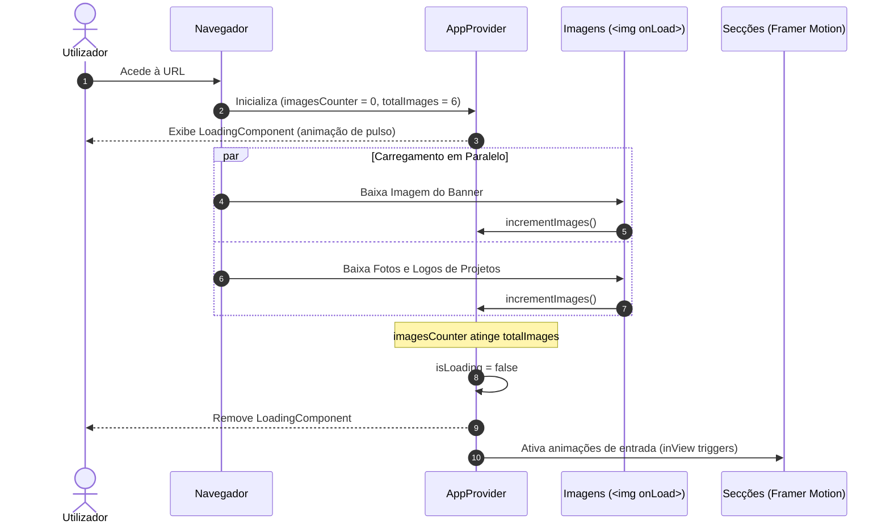

# Arquitetura do Sistema (`docs/architecture.md`)

Este documento descreve a organização estrutural, o fluxo de dados, a hierarquia de componentes e os padrões de desenho de software adotados no portfólio.

---

## 1. Visão Geral da Arquitetura

A aplicação é uma **Single Page Application (SPA)** focada em apresentação de perfil profissional e trabalhos. A arquitetura segue o modelo de **Component-Driven Development**, com forte separação entre:
1. **Componentes Básicos / Reutilizáveis (`src/components/`)**: Átomos e moléculas de UI (Cards, Contentores, Títulos, Navbar, Loader).
2. **Secções de Página (`src/sections/`)**: Organismos que compõem a narrativa da landing page (Banner, Educação, Experiências, Projetos, Competências e Rodapé).
3. **Estado Global / Contexto (`src/contexts/`)**: Gestão de pré-carregamento e estado transitório de carregamento.

```mermaid
flowchart TD
    subgraph UI ["Camada de Apresentação (View)"]
        App["App.tsx"]
        Provider["AppProvider (Context)"]
        Nav["Navbar (Horizontal / Vertical)"]
        Banner["Banner Section (#home)"]
        About["About Me Section (#about-me)"]
        Academic["Academic Section (#academic-education)"]
        Exp["Experiences Section (#experiences)"]
        Projects["Personal Projects Section (#projects)"]
        Leadership["Leadership Section (#leadership)"]
        Conferences["Conferences Section (#conferences)"]
        Langs["Technical Skills Section (#languages)"]
        Footer["Footer Section (#footer)"]
        Loading["LoadingComponent"]
    end

    subgraph Repositories ["Camada de Dados / Repositórios"]
        AboutRepo["LocalAboutRepository (src/repositories/local/about)"]
        AcadRepo["LocalAcademicRepository (src/repositories/local/academic)"]
        ExpRepo["LocalExperiencesRepository (src/repositories/local/experiences)"]
        ProjRepo["LocalProjectsRepository (src/repositories/local/projects)"]
        LeadershipRepo["LocalLeadershipRepository (src/repositories/local/leadership)"]
        ConferencesRepo["LocalConferencesRepository (src/repositories/local/conferences)"]
        SkillsRepo["LocalSkillsRepository (src/repositories/local/skills)"]
    end

    subgraph State ["Camada de Estado"]
        AppContext["AppContext (imagesCounter, isLoading)"]
        UseApp["useApp Hook"]
    end

    subgraph Assets ["Recursos Estáticos"]
        PublicAssets["Imagens & CV (public/)"]
    end

    App --> Provider
    Provider --> AppContext
    AppContext -.-> UseApp
    Provider --> Loading
    Provider --> Nav
    Provider --> Banner
    Provider --> About
    Provider --> Academic
    Provider --> Exp
    Provider --> Projects
    Provider --> Leadership
    Provider --> Conferences
    Provider --> Langs
    Provider --> Footer

    About -->|Consome Dados| AboutRepo
    Academic -->|Consome Dados| AcadRepo
    Exp -->|Consome Dados| ExpRepo
    Projects -->|Consome Dados| ProjRepo
    Leadership -->|Consome Dados| LeadershipRepo
    Conferences -->|Consome Dados| ConferencesRepo
    Langs -->|Consome Dados| SkillsRepo
    Banner -.->|Incrementa Contador| AppContext
    Banner -.-> PublicAssets
    Academic -.-> PublicAssets
```



---

## 2. Estrutura de Pastas e Módulos

```text
src/
├── main.tsx              # Ponto de entrada React (createRoot)
├── App.tsx               # Montagem das secções e injeção do AppProvider
├── index.css             # Importação das diretivas Tailwind base/components/utilities
├── vite-env.d.ts         # Declaração de tipos de ambiente Vite
│
├── repositories/         # Camada de abstração e acesso a dados (Repository Pattern)
│   ├── local/            # Repositórios locais tipados
│   │   ├── about/        # Dados biográficos e links
│   │   ├── academic/     # Histórico académico e certificações
│   │   ├── experiences/  # Experiência profissional estruturada
│   │   ├── projects/     # Projetos pessoais e destaques técnicos
│   │   ├── leadership/   # Atividades de liderança e mentoria
│   │   ├── conferences/  # Conferências e seminários internacionais
│   │   └── skills/       # Matriz técnica categorizada
│   └── index.ts          # Barrel export de repositórios
│
├── contexts/             # Contextos de estado global
│   └── app/
│       ├── index.tsx     # AppProvider com controlo de imagens carregadas
│       └── types.ts      # Contratos IContext e IProviderProps
│
├── hooks/                # Hooks customizados
│   └── useApp.ts         # Atalho de consumo do AppContext
│
├── components/           # Componentes atómicos e blocos de suporte
│   ├── about/            # Componente de bio (atualmente desativado)
│   ├── card/             # Hub de cards (Academic, Experience, Language, Project)
│   │   ├── academic/
│   │   ├── experience/
│   │   ├── language/
│   │   └── project/
│   ├── container/        # Container e Section wrappers com esquemas de cor
│   │   └── section/
│   ├── drawer/           # Painéis laterais e visualizadores (React Portal)
│   │   └── document/     # Visualizador vertical de PDFs (EmbedPDF)
│   ├── loading/          # Animação de tela de splash/loading (Framer Motion)
│   ├── navbar/           # Barra de navegação com suporte a versão mobile e desktop
│   │   ├── horizontal/   # Versão desktop com scroll suave
│   │   └── vertical/     # Drawer lateral retrátil para mobile
│   └── title/            # Padronização de títulos com sublinhado/divisor
│       └── primary/
│
└── sections/             # Blocos estruturais da página
    ├── banner/           # Hero section, apresentação, foto e botão de CV
    ├── about/            # Apresentação pessoal e pontos de contacto
    ├── academic/         # Formação académica e certificações
    ├── experiences/      # Histórico profissional com timeline e detalhe
    ├── projects/         # Projetos pessoais em destaque com imagens e links
    ├── leadership/       # Liderança, mentoria e supervisão de estágios
    ├── conferences/      # Conferências, seminários e visualizador de PDF
    ├── languages/        # Matriz categorizada de competências técnicas (Skills)
    └── footer/           # Rodapé institucional com direitos e GitHub
```

---

## 3. Gestão de Estado e Ciclo de Vida do Pré-Carregamento

O portfólio implementa uma estratégia de **Splash Screen / Preloader** para garantir que as animações e imagens não apareçam fragmentadas enquanto descarregam da rede.



---

## 4. Padrões de Navegação e Rolagem Suave (Smooth Scrolling)

* Em vez de rotas SPA tradicionais (`react-router-dom`), a aplicação é desenhada como **One-Page Storytelling**.
* A navegação é coordenada pelo pacote `react-scroll` via componente `<Link to="..." smooth spy offset={-60} />`.
* Cada secção possui um identificador unívoco (`id`):
  * `home` -> Banner principal
  * `academic-education` -> Formação académica
  * `experiences` -> Experiência profissional
  * `projects` -> Vitrina de projetos
  * `languages` -> Competências técnicas e linguagens
  * `footer` -> Informações finais

---

## 5. Padrões de Animação (Scroll-Triggered Animations)

* Os componentes utilizam `useInView(ref, { once: false })` em conjunto com `useAnimation()` do **Framer Motion**.
* Isso permite que os elementos reajam tanto na entrada como na saída do campo de visão (`viewport`), com transições de translação no eixo vertical (`y`) ou horizontal (`x`) e controlo de opacidade.
