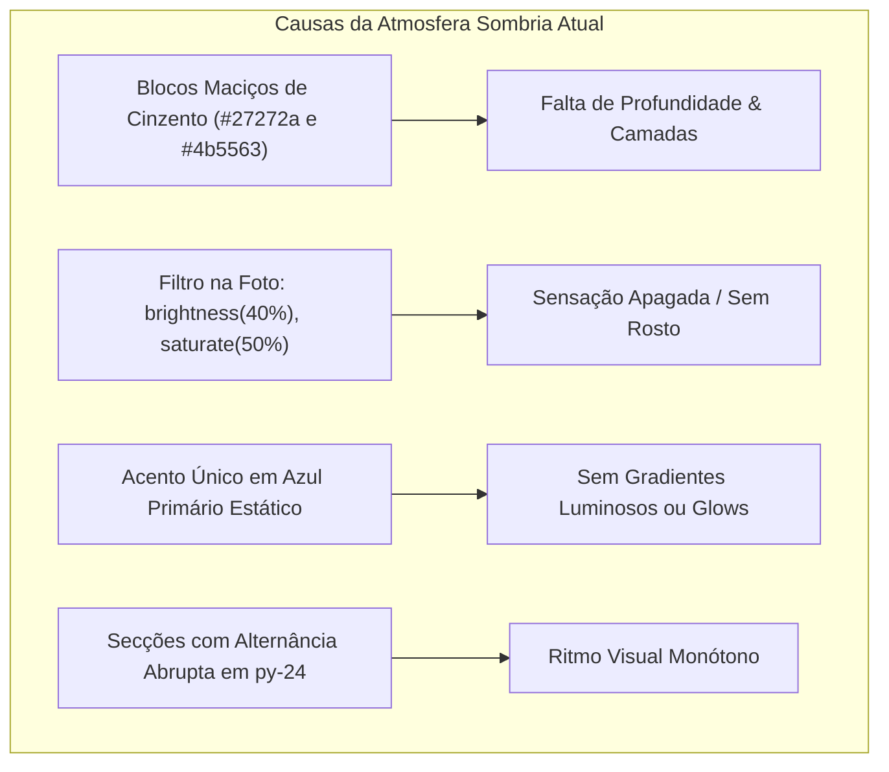

# Auditoria de Design: Navbar & Atmosfera Geral da Página (`docs/audit-design-navbar.md`)
## Desconstrução Crítica e Diagnóstico para Redesign

---

## 1. Resumo Executivo

Esta auditoria analisa a experiência visual e a usabilidade atual do portfólio de **Fábio Paulo**, com foco particular na **Navbar** e na **identidade cromática global**.

* **Problema Central Identificado:** O site transmite uma sensação pesada, fria e visualmente opaca devido ao uso predominante de blocos maciços de cinzento escuro (`#27272a`) e cinzento intermédio (`#4b5563`), agravado por filtros que reduzem o brilho das fotos a 40% e pela ausência de pontos focais de luz ou contraste dinâmico.
* **Objetivo:** Desconstruir a arquitetura visual da barra de navegação e do layout da página, apontando exatamente onde o design falha e propondo uma evolução estética para um padrão contemporâneo, vivo e de alto calibre profissional.

---

## 2. Diagnóstico da Navbar Atual

### 2.1. Layout e Hierarquia Visual
1. **Ausência de Identidade / Marca à Esquerda:**
   * O ficheiro [src/components/navbar/horizontal/index.tsx](file:///mnt/workstation/repositories/github/my-portfolio/src/components/navbar/horizontal/index.tsx) define classes para `.logo`, mas **o elemento de logo simplesmente não é renderizado** no JSX de desktop. A barra inicia vazia à esquerda.
2. **Centralização Absoluta Frágil:**
   * A lista horizontal de navegação está fixada no centro via `absolute top-1/2 left-1/2 transform -translate-y-1/2 -translate-x-1/2`. Esse posicionamento absoluto esconde o espaço lateral e impede a inclusão natural de botões de ação à direita.
3. **Ausência de Ação Rápida (CTA) à Direita:**
   * Uma barra de portfólio profissional moderna beneficia de ter no extremo direito um atalho direto (ex.: botão *"Contacto"*, link do *LinkedIn* ou atalho para o *GitHub*). Atualmente, a área direita está vazia.

### 2.2. Estilos e Cores da Navbar
1. **Fundo Oculto e Sólido (`bg-zinc-800`):**
   * A navbar usa um bloco cinzento opaco estático de 60px. Não existe transparência, desfoque de fundo (*backdrop-blur*) nem borda de vidro para separar a barra do conteúdo que rola por baixo.
2. **Contraste Quebrado no Hover:**
   * No ficheiro [src/components/navbar/horizontal/index.scss](file:///mnt/workstation/repositories/github/my-portfolio/src/components/navbar/horizontal/index.scss#L22-L24):
     ```scss
     li a {
       @apply text-sm text-gray-400 hover:text-gray-500 capitalize transition-all;
     }
     ```
     Ao passar o rato (*hover*), a cor muda de `text-gray-400` para `text-gray-500` — ou seja, **o texto fica mais escuro e menos legível** sobre o fundo escuro, violando a expectativa de iluminação e feedback positivo.
3. **Separadores Visuais com Ruído:**
   * Entre cada item do menu é renderizado um SVG com 3 círculos verticais (`li.separator`). Em ecrãs normais, isso cria ruído visual desnecessário e poluição gráfica, em vez de um espaçamento fluido e limpo.
4. **Estado Ativo Pobre:**
   * O estado ativo limita-se a `text-blue-400 font-bold`. Falta um indicador táctil envolvente (como uma pílula deslizante com fundo subtil ou linha de base animada).

### 2.3. Menu Móvel (Drawer Vertical)
* A gaveta usa `bg-zinc-800` com borda sólida e o fundo escuro (*backdrop*) tem apenas `opacity-25`, o que não dá destaque suficiente ao menu aberto em telemóveis.
* Falta agrupamento de redes sociais ou link direto para download de CV no menu móvel.

---

## 3. Diagnóstico do Design Geral & Atmosfera Escura

### 3.1. Por que o portal parece "muito escuro e sem vida"?



1. **A 'Armadilha do Cinzento Lamacento' (*Muddy Grays*):**
   * O fundo principal é `#27272a` (Zinc 800) e as secções alternadas usam `#4b5563` (Gray 600). Esta combinação cria um contraste opaco, lembrando interfaces de software de terminal antigas em vez de um portfólio digital moderno.
   * Não há transições suaves de luz nem áreas de respiro com gradientes etéreos ou radiais.
2. **Escurecimento Excessivo da Imagem Pessoal:**
   * Em [src/sections/banner/index.scss](file:///mnt/workstation/repositories/github/my-portfolio/src/sections/banner/index.scss#L68-L72):
     ```scss
     img {
       filter: brightness(40%) contrast(120%) saturate(50%);
     }
     ```
     A foto de apresentação tem o brilho cortado para **40%** e a saturação reduzida para **50%**. Isso retira o calor humano da página e transmite frieza ao visitante.
3. **Falta de Profundidade em Camadas (*Z-Depth*):**
   * Todos os cartões (educação, experiências, projetos) descansam diretamente sobre o fundo sem bordas translúcidas sutis (`border-white/5` ou `border-slate-700/50`), sem sombras com dispersão ampla (*ambient glow*) e sem elevações distintas.
4. **Ausência de Cores de Apoio:**
   * O único acento utilizado é o azul (#3b82f6). Falta uma paleta secundária de suporte (ex.: *Cyan, Violeta suave, Esmeralda para estados de sucesso/status, ou toques âmbar*) para criar vibração e interesse visual.

---

## 4. Proposta de Redesign da Navbar

### 4.1. Arquitetura da Nova Barra Flutuante (*Floating Glass Navbar*)

Propomos substituir a barra sólida de ponta a ponta por uma **Navbar Flutuante Desfocada** (*Floating Glass Dock*), padrão adotado por produtos de referência da indústria:

```text
+---------------------------------------------------------------------------------------+
|  [FP] Fábio Paulo        [ Início | Formação | Experiência | Projetos | Skills ]     [ Contactar ↗ ] |
+---------------------------------------------------------------------------------------+
```

1. **Identidade à Esquerda:**
   * Monograma estilizado `FP` com gradiente sutil ou nome "Fábio Paulo" com badge de status discreto (ex.: 🟢 *Disponível para novos desafios*).
2. **Cápsula de Links Central:**
   * Fundo translúcido com `backdrop-blur-md` e borda fina suave (`bg-slate-900/75 border border-slate-700/40 shadow-lg shadow-black/20`).
   * Eliminação dos separadores pontilhados.
   * Indicador ativo com efeito flutuante animado (*Pill Indicator* via Framer Motion `layoutId="navbar-active"`).
   * Hover luminoso: texto transita para branco puro (`text-white`), com brilho suave.
3. **Ações à Direita:**
   * Botão de conversão com destaque moderno: *"Contactar"* ou ícones de acesso rápido ao *LinkedIn* e *GitHub*.

---

## 5. Proposta para a Nova Paleta Cromática: "Vivo & Profissional"

Para eliminar o aspeto "escuro e morto" mantendo uma sofisticação profissional, propomos evoluir do cinzento neutro apagado para a família **Deep Tech Slate com Iluminação Atmosférica**:

| Elemento | Paleta Atual (Apagada) | Nova Paleta Proposta (Viva & Profissional) | Efeito Visual |
| :--- | :--- | :--- | :--- |
| **Fundo Global** | `#27272a` (Cinzento plano) | `#0a0e17` / `#0f172a` (Slate Noturno Profundo) | Cria uma base rica e luxuosa em vez de desbotada. |
| **Superfícies de Cards** | `#27272a` / `#4b5563` | `#131b2e` com bordas `border-slate-800` | Separação nítida em camadas com sombras elegantes. |
| **Luz Atmosférica** | Inexistente (só gradiente linear) | *Radial Glow* sutil no topo (Azul Índigo / Ciano difuso a 15%) | Traz sensação de luz ambiente e dinamismo. |
| **Acento Primário** | `#3b82f6` (Azul clássico) | `#38bdf8` (Sky 400) + `#6366f1` (Indigo 500) | Vibração visual e estética tecnológica moderna. |
| **Texto de Destaque** | `#f8fafc` | Gradiente sutil de texto (Branco para Cinza Platina) | Títulos com aspecto refinado e expressivo. |
| **Foto de Perfil** | `brightness(40%)` | `brightness(95%)` com máscara de gradiente na base | Rosto visível, humano e confiante. |

---

## 6. Próximos Passos (Fase 2)

1. **Atualizar o [docs/design.md](file:///mnt/workstation/repositories/github/my-portfolio/docs/design.md):** Formalizar os novos tokens de cor e classes no design system.
2. **Criar o ADR:** [docs/adr/001-redesign-navbar-e-tema.md](file:///mnt/workstation/repositories/github/my-portfolio/docs/adr/001-redesign-navbar-e-tema.md) documentando a decisão visual.
3. **Plano de Implementação:** [docs/plans/navbar-redesign.md](file:///mnt/workstation/repositories/github/my-portfolio/docs/plans/navbar-redesign.md) detalhando cada alteração no código da Navbar.
