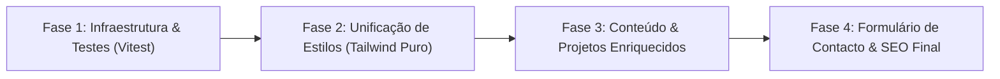

# Documento de Requisitos do Produto (`docs/prd.md`)
## Modernização e Evolução do Portfólio Pessoal

---

## 1. Resumo Executivo e Objetivos

* **Produto:** Portfólio Web Pessoal (Fábio Paulo).
* **Propósito:** Apresentar a trajetória profissional, projetos, competências técnicas e formação académica de forma moderna, rápida e responsiva.
* **Objetivo de Negócio:** Servir como cartão de visita profissional de alto impacto para recrutadores, gestores técnicos de engenharia e potenciais clientes ou parceiros.
* **Objetivo Técnico:** Atualizar e despoluir a base de código legada, resolvendo fragilidades de testes e complexidades de CSS híbrido, preparando o projeto para evoluções futuras com suporte de agentes de IA.

---

## 2. Diagnóstico do Estado Atual (*Pain Points*)

| Área | Situação Atual | Impacto / Problema |
| :--- | :--- | :--- |
| **Estilização** | Ficheiros `.scss` usando `@apply` do Tailwind misturado com CSS puro. | Duplicação de esforço, sobrecarga no build e inconsistência de manutenção. |
| **Testes** | Jest com suites a falhar por problemas de resolução de caminhos (`@/`). | Falta de segurança ao refatorar código legado. |
| **Projetos** | Cartões de projeto exibem apenas o logo e nome; descrições estão vazias e não há links para demos/código. | Baixo impacto visual e pouca demonstração real de competência técnica. |
| **Contacto** | Não existe formulário de contacto nem ligações diretas a redes como LinkedIn. | Atrito na conversão de visitantes em oportunidades de trabalho. |
| **Preloader** | O ecrã depende de contagem manual fixa (`totalImages = 6`). | Se uma imagem falhar ou for adicionada sem ajustar o número, o site fica preso em loading infinito. |
| **Secção About** | Código da secção "Sobre Mim" existe mas está comentado e inativo. | Perde-se a oportunidade de contar a história e valores do programador. |

---

## 3. Requisitos Funcionais (FR)

### RF01 - Hero & Banner Modernizado
* Manter dados centrais atualizados com suporte a botões rápidos de contacto social (LinkedIn, GitHub, Email e Download de CV).
* Manter foto de perfil com otimização WebP e suporte a carregamento progressivo (*blur-up*).

### RF02 - Vitrina de Projetos Enriquecida
* Cada projeto deve conter:
  * Título e subtítulo explicativo do problema resolvido.
  * Etiquetas de tecnologias utilizadas (ex.: React, TypeScript, Python, Docker).
  * Links funcionais para demonstração ao vivo (*Live Demo*) e repositório (*GitHub*), quando aplicável.
  * Modal ou gaveta de detalhes expandidos.

### RF03 - Seção de Experiência e Formação Atualizada
* Linha do tempo visualmente unificada com separação clara entre funções de desenvolvimento e estágios de investigação.
* Destaque para resultados concretos e impactos obtidos em cada empresa.

### RF04 - Nova Secção de Contacto Ativa
* Implementar secção de contacto com:
  * Formulário direto (Nome, Email, Mensagem) com integração de baixo custo (ex.: Web3Forms, Formspree ou EmailJS).
  * Informações de contacto diretas e links para redes profissionais.

### RF05 - Secção de Competências (Skills) Reorganizada
* Categorização de competências por área (Frontend, Backend, DevOps/Ferramentas).
* Substituição ou melhoria dos gráficos circulares por cartões interativos com tags e ícones modernos.

---

## 4. Requisitos Não-Funcionais (NFR)

* **RNF01 - Performance (Core Web Vitals):**
  * Pontuação mínima de 90 no Google Lighthouse (Performance, Acessibilidade, Boas Práticas, SEO).
  * LCP (*Largest Contentful Paint*) inferior a 2.0s em redes 4G móveis.
* **RNF02 - Acessibilidade (a11y):**
  * Cumprimento de padrões WCAG 2.1 AA (contraste de cor adequado, navegação por teclado, rótulos `aria-label` em links de ícones).
* **RNF03 - Arquitetura de Estilos:**
  * Transição progressiva de `.scss` para Tailwind CSS 100% utilitário (ou com suporte a tokens semânticos centralizados).
* **RNF04 - Testes e CI/CD Confiável:**
  * Migração do runner de testes de Jest para **Vitest**, reaproveitando nativamente os plugins e aliases do Vite.
  * Execução dos testes automatizada em GitHub Actions em cada Pull Request.

---

## 5. Roteiro de Implementação Sugerido (Roadmap)

1. **Fase 1 - Estabilidade Técnica e Infraestrutura:**
   * Migrar de Jest para Vitest.
   * Corrigir os testes existentes que falham e garantir pipeline 100% verde.
   * Tornar o preloader resiliente (timeout fallback em vez de contador rígido).
2. **Fase 2 - Refatoração do Design System:**
   * Eliminar ficheiros `.scss` desnecessários, convertendo as classes para classes utilitárias no próprio JSX.
   * Padronizar tokens no `tailwind.config.js` (cores da marca, tamanhos).
3. **Fase 3 - Conteúdo & Enriquecimento de Projetos:**
   * Reativar e modernizar a secção "Sobre Mim" (`about`).
   * Adicionar detalhes, descrições e links reais aos projetos.
4. **Fase 4 - Nova Secção de Contacto e Otimizações Finais:**
   * Integrar formulário de contacto funcional.
   * Validação de contraste, acessibilidade e SEO meta tags.
